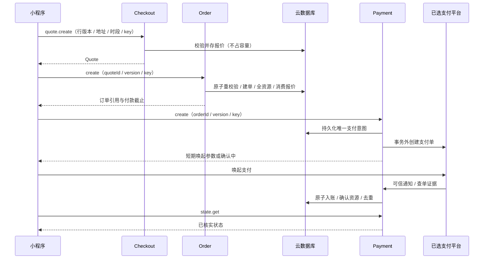

> 技术参考。当前部署/验收状态不在此维护；历史实现描述不能视为已接入。

## quote → order → payment 时序

1. quote.create 提交袋选中行 / 版本、履约、联系人、本人地址、slotId、报价 key。服务端读取真实袋 / 目录 / 发布配置 / 地址 / 时段；D03 验规格 / 数量 / 留言 / 整数分，D05 验范围 / 日期 / 提前量 / 名额，D02 捕获事实并存 ACTIVE 报价，不占资源。

报价网络入口为checkout函数的quote.create/quote.get，沿用上述公开参数；服务端只接受原生身份，不接受客户端价格、权限、坐标证明、开关或时钟。创建在同一SDK事务中保护用户、现行业务快照及素材/门店位置证明，显式新增checkout_quotes与idempotency_records；配送同时新增delivery_evaluations，绑定报价、本人地址版本/指纹、当前规则和范围结果。回执result仅含entityId/version/errorCode；同key异参拒绝，同key重放返回原报价并复核当前身份与事实，失效或变化必须重新报价。quote.get只读，不新增回执或保护写。

成功DTO为现有projectQuotePreview白名单，scope=CLOUD_QUOTE，附capacityReserved=false、stockReserved=false、checkoutAllowed=false；不返回owner、位置证明、内部保护计数或原生标识。DESIGN_PREVIEW仅在development且服务端显式启用参考图时可用于报价，仍须PUBLIC_CATALOG素材审批、云路径白名单和assetId/revision/storageRef/sourceKind精确绑定；快照保留DESIGN_PREVIEW，不重标实拍。test/production保持实拍要求。未知经营值、未发布门店/配置或未初始化资源不能生成报价。

单次SDK尝试最多100次文档读写（含全部保护写）、单文档规范JSON最多64KiB、总载荷最多1MiB、SDK最多3尝试且总时长小于15秒；首写前合并完整读集与新增记录预算。此为传输边界，不替代经营袋行/数量上限；超预算返回配置未就绪，不拆成多个非原子事务。报价提交前再次检查有效期，已执行的保护写与新增记录随失败回滚。

delivery_evaluations字段：_id=报价deliverySnapshot.evaluationId，schemaVersion=1/version=0，ownerId/storeId/quoteId，createdAt/updatedAt/evaluatedAt，evaluationFingerprint、bindings、addressSnapshot、range、deliveryFacts。仅服务端按evaluateDeliveryInput结果构造；不得作为客户端自报位置或费用的凭据，也不代表资源已占用。配送地址由address函数同一私密密钥验HMAC，门店证明按当前门店版本和精确坐标指纹校验；地图查询不得进入事务回调。

2. 用户确认 Quote 后 order.create 提交 quoteId/expectedQuoteVersion/下单 key。云端复核归属 / 时效 / 未消费、现行事实 / 商品 / 地址版本 / 发布配置 / 范围 / 时段 / 库存；同一真实事务写订单头 / 行 / 日志 / reservations、更新全资源、消费报价、记录幂等。失败不留半单或局部占用。
3. 一报价最多一个 consumedOrderId。同键返回原结果；不同键也不能再次消费；同本人已有 consumedOrderId 可受限返回原单引用。事实变化 QUOTE_CHANGED 须重新确认，不能自动涨价。
4. 返回 PENDING_PAYMENT 与统一付款截止。payment.create 读取本人订单状态和金额，先持久化唯一未决意图 / 商户号，再事务外调选定适配器；无真实接入配置明确失败，不生成模拟唤起参数。

5. 前端唤起支付后无论成功 / 取消 / 失败，只查询 payment.state.get；不写付款轴。可信通知 / 查单核对商户 / AppID / 意图 / 币种 / 全额分金额，按事件与交易号去重入账。未知展示确认中，重复请求沿用原意图。
6. 可信付款才 PAID、资源 CONFIRMED。取消 / 过期先查单 / 关单，未知不释放；取消后迟到实付记账并计划全额退款，保持取消。退款持久化审批意图后事务外发起，重试同退款号，失败仍占预算。

2026-10-05 P02 已在离线注入事务服务验证唯一意图、独立商户号、受控预算与跨 key 复用；claimDispatch 的一次发送占权 / token 是内部要求，不是公开 action。仅返回不可调用计划、payInvocation=null；发送后未知 / 响应丢失只要求查单，尚未执行外部调用、签发 READY 参数或实现 state.get handler / 关闭后重付。现有 PaymentSession 仍是目标协议，不将内部发送数据直接投影；真实传输格式继续待 E03/P01。见 [P02](../../archive/stages/phase-7.md#p02-payment-intents)。

2026-10-05 P03 注入来源边界后的业务核验、通知 / 交易双去重、原子入账 / 资源确认及异常资金隔离离线通过；没有真实 callback 传输格式、原始字节验签 / 解密、平台转发认证或 HTTP 应答。处理结果不投影成 PaymentSession，也不开放客户端 SYSTEM action。未来应答必须晚于资金处理或可信恢复证据持久提交；无云时不能拿内部 sourceAccepted 冒充成功应答。下一项 P04 查单 / 关单与迟到款协调，见 [P03](../../archive/stages/phase-7.md#p03-payment-notifications)。

P04 本地恢复请求先提交再输出内部查询 / 关闭要求，实际网络执行器尚未实现。经注入验证的结果按原请求绑定：查询 SUCCESS 共用资金去重；关闭空 ACK / 未知只要求查询，可信 CLOSED 才写摘要并允许 O05 重新取消。迟到款补偿意图与告警需求持久保存，退款 / 告警传输待接入；不新增用户 SYSTEM action 或真实网络协议字段。见 [P04](../../archive/stages/phase-7.md#p04-payment-recovery)。

## development 页面报价预览

客户端公开配置checkout.enabled默认关闭；仅development/cloud且云袋、门店、地址服务均配置后开启。购物袋预览只使用新读取的本人云袋及其行版本，不导入本机旧草稿；store.slots.list提供真实可选时段，地址从同一原生subject的云地址簿读取。页面保存的选择只含cartId、袋/行版本及subjectHash，金额和商品展示以新读取结果及最终报价为准。

quote.create的完整payload/key在调用前按app/环境/subjectHash隔离保存；未知结果保留原请求，相同意图重试沿用原key，不同意图返回BUSY。明确终态错误清理记录，原账户仍可恢复其未确认请求；换号响应不得展示。成功响应再读取本人袋核对身份/版本。Quote DTO商品项不含购物袋lineId，按productId/skuId/数量/留言多重集合与原选择核对，核验行金额与总额；展示使用报价返回的商品信息和金额。

切换日期、时段、履约方式或联系人立即使显示报价失效；地址变更同样重新核验，页面隐藏后的旧响应不回写。有效期结束清除有效报价，保留过期提示；每次新请求清理旧到期计时器。原子报价不预留资源，页面始终保持checkoutAllowed=false且主下单按钮禁用，不调用order/payment。DESIGN_PREVIEW来源保留并在页面说明。

## development 原生 order.create 候选

order 云函数复用 order-sdk-session 与真实报价的媒体/位置上下文，仅支持 create。JJL_ORDER_CREATE_ENABLED 默认 false，仅 development 且固定门店可开启；不增加客户端 order allowlist。原生身份、本人报价和门店绑定同时覆盖创建与原键重放，客户端不传价格、资源或身份。

事务原子写入订单、明细、预留、日志及幂等回执，并消费报价；失败回滚。响应仅 CommandResult 的 entityId、version、errorCode，不外露内部事务结果。此入口不清理购物袋；后续支付确认才能按原快照处理。

部署固定 SDK4.0.2 / Nodejs20.19 / 20秒，单次事务预算100操作、80读/80写、单文档64KiB、累计1MiB、最多3尝试15秒。orders.orderNo 需要唯一索引，orders/order_items/reservations/order_logs 客户端读写拒绝。未付款到期/取消的原子资源释放与正式云端验收完成前，保持建单关闭。
